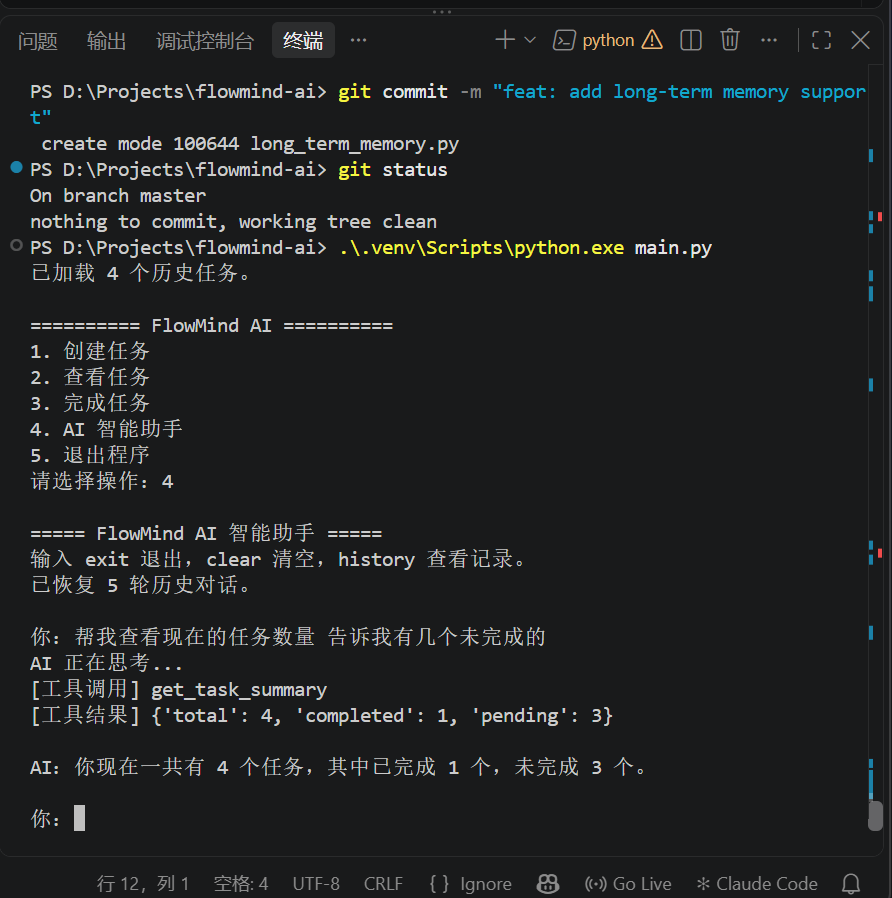

# 🌙 FlowMind AI

> 一个基于 Python 与大语言模型的智能任务管理 Agent，正在逐步发展为具备长期记忆、工具调用和自动化工作流能力的 AI 应用平台。

## 📖 项目简介

FlowMind AI 是一个个人独立开发的 AI Agent 项目。

项目基于 DeepSeek 大模型 API，通过 Function Calling 实现模型与本地任务管理工具的交互，并通过 JSON 文件持久化聊天历史与结构化长期记忆。

目前项目处于 CLI（命令行）MVP 阶段，后续计划引入 FastAPI、Vue 3 和 LangGraph，逐步构建完整的 Web AI Agent 平台。

## ✨ 已实现功能

### 1. 任务管理
- 创建任务
- 查看任务列表
- 标记任务为已完成
- 使用 JSON 持久化任务数据
- 自动管理任务 ID

### 2. AI 智能对话
- 接入 DeepSeek 大模型 API
- 支持多轮对话
- 支持查看与清空聊天历史
- 支持上下文窗口限制
- 具备基本的 API 异常处理

### 3. Function Calling
- 支持模型自主选择任务统计工具
- 查询任务总数、已完成数量和未完成数量
- 支持工具执行结果回传模型
- 设置工具调用轮数上限

### 4. 记忆系统
- Memory v1：聊天历史持久化
- Memory v2：结构化长期记忆
- 支持新增、更新、查询和删除记忆
- 支持跨会话恢复历史
- 区分聊天历史与长期记忆
- 用户可以主动控制长期记忆内容

## 🛠 技术栈

| 分类 | 技术 |
|------|------|
| 编程语言 | Python |
| 大语言模型 | DeepSeek API |
| 模型调用 | OpenAI Python SDK |
| Agent 基础 | Function Calling |
| 数据持久化 | JSON |
| 配置管理 | python-dotenv |
| 版本管理 | Git |
| 开发工具 | Visual Studio Code |

## 📂 项目结构

```text
flowmind-ai/
├── main.py                 # 程序入口、CLI 与任务管理
├── ai_service.py           # 大模型调用与工具调用
├── memory.py               # 聊天历史持久化
├── long_term_memory.py     # 结构化长期记忆
├── requirements.txt        # Python 依赖
├── .gitignore              # Git 忽略规则
└── README.md               # 项目说明
```

以下文件由本地环境生成，不应提交到 GitHub：

- `.env`：API Key
- `.venv/`：虚拟环境
- `tasks.json`：任务数据
- `chat_history.json`：聊天记录
- `long_term_memory.json`：长期记忆数据

## 🚀 本地运行

### 1. 克隆项目

```bash
git clone <你的GitHub仓库地址>
cd flowmind-ai
```

### 2. 创建虚拟环境

```powershell
py -m venv .venv
```

### 3. 安装依赖

```powershell
.\.venv\Scripts\python.exe -m pip install -r requirements.txt
```

### 4. 配置 API Key

在项目根目录创建 `.env` 文件：

```dotenv
DEEPSEEK_API_KEY=your_api_key_here
```

请使用自己的 DeepSeek API Key，勿将真实密钥上传到 GitHub。

### 5. 启动程序

```powershell
.\.venv\Scripts\python.exe main.py
```

启动后可通过命令行菜单管理任务或进入 AI 对话。

## 🧠 长期记忆命令

| 命令 | 功能 |
|------|------|
| `/remember key value` | 保存或更新记忆 |
| `/memories` | 查看长期记忆 |
| `/forget key` | 删除一条记忆 |
| `/clear-memory` | 清空全部长期记忆 |
| `history` | 查看聊天历史 |
| `clear` | 清空聊天历史 |
| `exit` | 退出 AI 对话 |

示例：

```text
/remember assistant_name 鱼鱼
/remember user_name BabyMoon
/remember project_name FlowMind AI
```

长期记忆与聊天历史独立保存。清空聊天历史不影响长期记忆。

## 🗺 开发路线

- [x] Week 1：Python 项目初始化
- [x] CLI 任务管理
- [x] JSON 数据持久化
- [x] DeepSeek API 集成
- [x] 多轮对话
- [x] Function Calling 工具调用
- [x] Memory v1：聊天历史
- [x] Memory v2：结构化长期记忆
- [ ] 工程化测试与代码重构
- [ ] FastAPI 后端服务
- [ ] SQLite / PostgreSQL 数据库
- [ ] Vue 3 Web 前端
- [ ] LangGraph 工作流
- [ ] 智能表情包检索工具
- [ ] Docker 部署
- [ ] Agent 效果评测

## 🔐 安全说明

- API Key 通过环境变量加载
- 本地聊天记录和长期记忆不提交到公开仓库
- 模型工具调用由 Python 后端执行
- 当前仅开放受控的任务查询工具
- 用户可以查看、修改和删除长期记忆

## 📌 项目状态

当前版本：CLI MVP（持续开发中）

本项目用于学习和实践 AI Agent 工程、Python 软件开发与大模型应用架构。

## 👩‍💻 开发者

BabyMoon

个人独立学习与开发项目。

## 📸 项目演示

